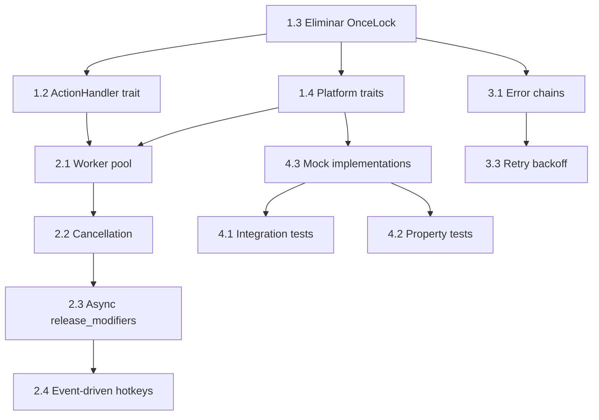

# Quick Actions — Plan de Mejoras de Calidad y Mantenibilidad

> Documento maestro para seguimiento de refactorizaciones y mejoras técnicas.
> Marca con `[x]` las tareas completadas.
>
> **Fuente única de verdad del refactor**: las Fases 1–5 se trackean aquí.
> El bloque de producto (R1–R6 infra + P1–P7 features) quedó registrado en
> `docs/plans/improvements-v0.3.md` como historial — no duplicar checkboxes ahí.

---

## Resumen de Fases

| Fase | Enfoque | Estado | Prioridad |
|------|---------|--------|-----------|
| 1 | Desacoplamiento y modularización | ⬜ Pendiente | 🔴 Alta |
| 2 | Concurrencia robusta | ⬜ Pendiente | 🔴 Alta |
| 3 | Manejo de errores y observabilidad | ⬜ Pendiente | 🟡 Media |
| 4 | Testing y abstracción de plataforma | ⬜ Pendiente | 🟢 Baja |
| 5 | Quick Wins (ganancias rápidas) | ⬜ Pendiente | 🟢 Baja |

> **Bloque producto v0.3 ✅ completado** (R1–R6 + P1–P7, commits `b49336a`..`05b9226`):
> autostart, pausa de hotkeys, modelo on-the-fly, check de updates, installer PS1,
> icono tray embebido y CapsLock configurable. 31 tests cross + clippy + cross-check.
> Pendiente: test manual en Windows.

---

## Fase 1: Desacoplamiento y Modularización 🔴

### 1.1 Dividir `ui.rs` (653 líneas → módulos pequeños)

- [x] Extraer el protocolo UI a `ui_protocol.rs` (hecho en P4, 2026-10-18):
  `UiCommand`, `ResultData`, `HistoryData`, `HistoryEntryView`, `UiChannels`
  están **fuera de egui** (cross-platform con tests); `ui.rs` (windows-only,
  render) los re-exporta

- [ ] Crear `src/ui/window_manager.rs` — gestión de viewport, mostrar/ocultar, centrado
- [ ] Crear `src/ui/toast.rs` — overlay de estado (loading/error) con animación
- [ ] Crear `src/ui/tabs/result_tab.rs` — pestaña de resultado (original + corregido + copiar)
- [ ] Crear `src/ui/tabs/history_tab.rs` — pestaña de historial con lista y botón copiar
- [ ] Crear `src/ui/tabs/help_tab.rs` — pestaña de ayuda estática
- [ ] Crear `src/ui/tabs/mod.rs` — trait `Tab` común + enum `TabKind`
- [ ] Refactorizar `QuickActionsApp` para delegar a `Tab` activos
- [ ] Reducir campos de `QuickActionsApp` de 17 a ~8 (delegar estado a tabs)

**Criterio de aceptación**: `ui.rs` < 200 líneas, cada tab < 100 líneas, compila y funciona igual.

---

### 1.2 Extraer `ActionHandler` trait (desacoplar `actions.rs` de `ui.rs`)

- [x] Extraer el protocolo de datos a `ui_protocol.rs` (hecho en P4) — los
  comandos y structs ya no dependen de egui; 1.2 acota el acople restante:
  `actions.rs` todavía importa `crate::ui` (re-export de ui_protocol) y
  `help_text()` genera texto de UI (migrar ambos)
- [ ] Definir trait `ActionHandler` en `src/actions/trait.rs`:
  ```rust
  pub trait ActionHandler: Send + Sync {
      fn handle(&self, cmd: HotkeyCommand, ctx: &ActionContext) -> Result<()>;
  }
  ```
- [ ] Crear `ActionContext` struct con: `config`, `clipboard`, `history`, `ui_tx`, `ollama_client`
- [ ] Implementar `DefaultActionHandler` en `src/actions/handlers.rs` (lógica actual)
- [ ] Inyectar `Arc<dyn ActionHandler>` en `QuickActionsApp` en lugar de llamar `actions::handle_command` directo
- [ ] Permitir mock en tests

**Criterio de aceptación**: `actions.rs` importa solo `crate::ui_protocol::...`
(ya no `crate::ui`), `help_text()` vive en módulo UI, test unitario de handler
sin UI.

---

### 1.3 Eliminar estado global (`OnceLock`) ✅

- [x] Crear `src/app_state.rs` — struct `AppState` con lo compartido real (post P1–P7):
  ```rust
  pub struct AppState {
      pub config: Arc<RwLock<Config>>,             // hot-reload (P3)
      pub config_path: PathBuf,                    // persistencia toml_edit (U4)
      pub suspendido: Arc<AtomicBool>,             // P2: pausa hotkeys
      pub clipboard: Arc<ClipboardManager>,
      pub history: Arc<Mutex<History>>,
      pub ollama_models: Arc<RwLock<Vec<String>>>, // cache submenu modelo (P3)
      pub models_fetching: Arc<AtomicBool>,        // guardia anti-refetch
      pub ui_tx: Sender<UiCommand>,
      pub ui_ctx: Arc<OnceLock<egui::Context>>,    // cablea en 1er frame
      pub repaint: RepaintFn,                      // ex `ui::request_repaint`
      pub hook_modifier / hook_capsmode,           // P7: aplicado al arrancar
  }
  ```
  `action_handler` falta hasta 1.2; `RepaintFn` vive en `ui_protocol` (cross).
- [x] Pasar `Arc<AppState>` a: `QuickActionsApp`, hotkeys thread, tray thread, workers
- [x] Eliminar `SENDER` en `win_hook.rs` → inyectado por `start_listener(sender, ...)`
- [x] Eliminar `SUSPENDED` en `win_hook.rs` (P2) → inyectado por `start_listener`
- [x] Eliminar `MODIFIER`/`CAPS_MODE` en `hotkeys/mod.rs` (P7) → capturados al crear el listener: params de `start_listener` + snapshot en `AppState::hook_modifier`/`hook_capsmode`
- [x] `LATCHED`/`SWALLOW_CAPS_UP` en `win_hook.rs` (P7) → encapsulados en `HookState` (struct del thread del hook en `thread_local`; los callbacks extern "system" no pueden capturar y los eventos LL llegan en el thread del pump, así que el thread-local es su sitio natural)
- [x] Eliminar `CONTEXT` en `ui.rs` → `AppState.ui_ctx` (per-instancia, cableada en el primer frame por el propio App) + `RepaintFn` inyectada a hook/tray/workers
- [x] Eliminar `TRAY_DATA` en `tray.rs` → el wnd proc recibe el estado via `GWLP_USERDATA` (canonico Win32; leak intencional, el tray vive hasta el exit)
- [x] Mantener `RUNTIME` en `runtime.rs` (aceptable, per plan)

**Criterio de aceptación**: Cero `OnceLock` en código de negocio ✅ y todo
inyectado; los statics restantes del hook (latch P7) quedan encapsulados y
documentados en `win_hook` ✅ (`HOOK_STATE`, thread-local de su thread).

**Extra de la pasada**: `refresh_models()` movido de `tray.rs` a
`AppState::spawn_models_refresh()` (la pestana Ajustes ya no llama al tray) y
`KeySimulator::copy/paste/select_all` reciben el `Modifier` por parametro
(observaba el static eliminado para soltar el modificador fisico).

---

### 1.4 Capa de abstracción de plataforma

- [ ] Crear `src/platform/` con traits:
  - `ClipboardProvider` — `get_text()`, `set_text()`, `backup()`, `restore()`, `clear()`
  - `KeySimulator` — `copy()`, `paste()`, `select_all()`, `end()`, `shift_home()`
  - `HotkeyListener` — `start(sender: Sender<HotkeyCommand>) -> Result<JoinHandle<()>>`
- [ ] Implementar `WindowsClipboard`, `WindowsKeySim`, `WindowsHotkeyListener` en `src/platform/windows/`
- [ ] Implementar `MockClipboard`, `MockKeySim`, `MockHotkeyListener` en `src/platform/mock/` para tests
- [ ] `main.rs` usa `cfg(windows)` solo para elegir implementación real vs mock

**Criterio de aceptación**: `clipboard.rs`, `key_sim.rs`, `hotkeys/` no tienen `#[cfg(windows)]` interno.

---

## Fase 2: Concurrencia Robusta 🔴

### 2.1 Pool de workers acotado (reemplazar `std::thread::spawn` por hotkey)

- [ ] Añadir `tokio::sync::Semaphore` en `AppState` (ej. `MAX_CONCURRENT_ACTIONS = 3`)
- [ ] En `process_hotkeys`: `semaphore.acquire().await` antes de spawnear tarea
- [ ] Usar `tokio::task::spawn` en lugar de `std::thread::spawn`
- [ ] Liberar permit en `finally` / `drop` guard
- [ ] Rechazar hotkey si pool lleno (feedback toast "Ocupado, intenta de nuevo")

**Criterio de aceptación**: Bajo carga rápida (spam hotkeys), no se crean threads ilimitados.

---

### 2.2 Cancelación cooperativa para requests Ollama

- [ ] Añadir `CancellationToken` (o `tokio_util::sync::CancellationToken`) en `AppState`
- [ ] `OllamaClient::generate` acepta `&CancellationToken` y verifica `.is_cancelled()` entre awaits
- [ ] En shutdown (tray "Salir" o Ctrl+C): `token.cancel()` + esperar workers con timeout
- [ ] Timeout por request configurable (`config.ollama.timeout_seconds` ya existe)

**Criterio de aceptación**: Cierre limpio en < 2s aunque haya request Ollama colgado.

---

### 2.3 `release_modifiers` async con timeout (no busy-wait bloqueante)

> Nota 2026-10-19: P7 lo dejó **parcial** — ahora espera el VK del modificador
> configurado (Alt o CapsLock, no solo Alt) pero sigue busy-wait con
> `thread::sleep`. Falta async + timeout configurable.

- [ ] Mover lógica a `KeySimulator::wait_for_modifiers_release(timeout: Duration) -> Result<()>`
- [ ] Usar `tokio::time::sleep` + `tokio::time::timeout` en lugar de `thread::sleep` + loop
- [ ] Ejecutar en `tokio::task::spawn_blocking` (llama WinAPI `GetAsyncKeyState`)
- [ ] Timeout configurable (default 2s), error si no se libera → toast "Suelta el modificador"

**Criterio de aceptación**: Worker no bloquea thread pool esperando tecla.

---

### 2.4 Event-driven hotkeys (eliminar polling en `process_hotkeys`)

- [ ] Cambiar `hotkey_rx: Receiver<HotkeyCommand>` a `async channel` (`tokio::sync::mpsc`)
- [ ] En `QuickActionsApp::update`: `while let Ok(cmd) = hotkey_rx.try_recv()` → `select!` o task dedicada
- [ ] Opción B: Spawn task `hotkey_processor` que recibe del canal y envía `UiCommand` al UI channel

**Criterio de aceptación**: No hay loop `try_recv` cada frame (30ms).

---

## Fase 3: Manejo de Errores y Observabilidad 🟡

### 3.1 Error chains con `#[source]` (thiserror)

- [ ] Revisar `AppError` variants: añadir `#[source]` donde wrappea error externo
- [ ] `Clipboard(String)` → `Clipboard { msg: String, #[source] source: arboard::Error }`
- [ ] `Ollama(String)` → `Ollama { msg: String, #[source] source: reqwest::Error }`
- [ ] `Keyboard(String)` → `Keyboard { msg: String, #[source] source: enigo::Error }`
- [ ] Propagar con `?` en lugar de `map_err(|e| AppError::X(format!("...{e}")))`

**Criterio de aceptación**: `error.source()` chain completo hasta causa raíz.

---

### 3.2 Logging estructurado (tracing fields)

- [ ] En `actions.rs` handlers: `tracing::info!(hotkey = ?cmd, chars = input.len(), model = %config.ollama.model, "Iniciando acción")`
- [ ] En `ollama.rs`: `tracing::debug!(duration_ms, status, "Ollama response")`
- [ ] En `clipboard.rs`: `tracing::warn!(error = %e, "Fallback clipboard read")`
- [ ] Configurar `tracing_subscriber::fmt().json()` en release para logs parseables
- [ ] Añadir `tracing-appender::rolling` ya está — bien

**Criterio de aceptación**: Logs en JSON con campos consistentes, filtrADS por `hotkey`, `duration_ms`.

---

### 3.3 Retry con backoff exponencial para Ollama

- [ ] Añadir `tower::retry` o implementar `retry_with_backoff` simple:
  ```rust
  async fn generate_with_retry(&self, ..., max_retries: u32) -> Result<String>
  ```
- [ ] Backoff: 500ms, 1s, 2s, 4s... (configurable)
- [ ] Retry solo en errores transitorios: connect, timeout, 5xx
- [ ] No retry en 4xx (bad request) ni respuesta vacía
- [ ] Log cada intento: `tracing::warn!(attempt, error, "Retrying Ollama")`

**Criterio de aceptación**: Desconexión temporal de Ollama no rompe la acción, reintenta y recupera.

---

### 3.4 Métricas básicas (opcional)

- [ ] Contadores: `hotkeys_total`, `ollama_requests_total`, `ollama_errors_total`, `clipboard_errors_total`
- [ ] Histogramas: `ollama_latency_ms`, `action_duration_ms`
- [ ] Exponer via `metrics-exporter-prometheus` o log periódicamente

---

## Fase 4: Testing y Abstracción de Plataforma 🟢

### 4.1 Tests de integración (mock Ollama)

- [ ] Añadir `testcontainers` o `mockito` en `dev-dependencies`
- [ ] Test: modificador+G (configurable, ver P7) → clipboard → Ollama mock → clipboard paste → history entry
- [ ] Test: Historial persiste y carga tras reinicio
- [ ] Test: Timeout Ollama → retry → success
- [ ] Test: Cancelación en shutdown

---

### 4.2 Property-based tests

- [ ] Añadir `proptest` en `dev-dependencies`
- [ ] `text_utils::extraer_contexto` — propiedades: idempotencia, preservación de texto sin corchetes
- [ ] `history::History::push` — max entries respetado, orden LIFO

---

### 4.3 Mock implementations para platform traits

- [ ] `MockClipboard` — `HashMap` en memoria, configurable fallos
- [ ] `MockKeySim` — registra llamadas, verifica secuencia
- [ ] `MockHotkeyListener` — inyecta comandos en test
- [ ] Tests unitarios de `ActionHandler` sin Windows ni UI

---

## Fase 5: Quick Wins (Ganancias Rápidas) 🟢

| # | Mejora | Archivo | Esfuerzo |
|---|--------|---------|----------|
| 5.1 | Batch/debounce `history.save()` (no en cada push) | `history.rs` | 🟢 Bajo |
| 5.2 | Mover timeouts/magic numbers a `config.toml` | `key_sim.rs`, `ui.rs` | 🟢 Bajo |
| 5.3 | Constantes para repaint intervals (30ms/5000ms) | `ui.rs:625` | 🟢 Bajo |
| 5.4 | Mapear VK codes desde config (no hardcoded 0x47, 0x54...) | `win_hook.rs`, `config.rs` | 🟡 Medio |
| 5.5 | `OllamaClient` reusa `reqwest::Client` ✓ (ya ok) | `ollama.rs` | — |
| 5.6 | `ClipboardManager::get_text` — mejorar detección "vacío" (no string match) | `clipboard.rs` | 🟢 Bajo |
| 5.7 | `config.toml` — añadir `max_concurrent_actions`, `modifier_release_timeout_ms` | `config.rs` | 🟢 Bajo |
| 5.8 | `build.sh` — cargo test antes de copiar exe | ✅ **hecho en R6** (preflight: fmt + test + clippy) | — |

---

## Dependencias entre Tareas



**Orden recomendado**: 1.3 → 1.4 → 1.1 → 1.2 → 2.1 → 2.2 → 2.3 → 2.4 → 3.1 → 3.2 → 3.3 → 5.x → 4.x

---

## Registro de Cambios

| Fecha | Fase | Tarea | Commit | Notas |
|-------|------|-------|--------|-------|
| 2026-08-09 | — | Documento creado | — | Baseline |
| 2026-10-17 | R | R1–R6 infra: LICENSE, panic hook, CI (ci.yml), release.yml, build.sh preflight (fmt+test+clippy), rustfmt repo | `b49336a` | |
| 2026-10-17 | — | rustls 0.23.46 (fix CVE TLS 1.3, alert #1) | `ea0c889` | PR #1 dependabot |
| 2026-10-17 | P | P1 autostart: HKCU Run + toggle tray + persistencia toml_edit | `24d77a0` | |
| 2026-10-17 | P | P2 pausa de hotkeys: `SUSPENDED` passthrough total + toast ámbar | `54fbede` | docs `902c55c` |
| 2026-10-17 | P | P3 modelo on-the-fly: submenu tray + hot-reload config | `b9b1c06` | `write_config_key` común |
| 2026-10-18 | P | P4 check de updates (GitHub API) + **extracción `ui_protocol.rs`** | `480d7eb` | 29 tests |
| 2026-10-18 | P | P5 install/uninstall PS1 + assets en release | `fb57fcd` | test en Windows pendiente |
| 2026-10-18 | P | P6 icono tray propio embebido: `build.rs` windres → `.rsrc` linkeado directo | `1cbf6cc` | exe + Explorer |
| 2026-10-18 | P | P7 CapsLock como modificador configurable (hold/toggle) | `05b9226` | hotkeys cross → 31 tests |
| 2026-10-19 | — | Doc actualizado al estado post-P1–P7 | *(commit docs)* | AppState sketch real, 5.8 hecho |
| 2026-10-25 | 1 | 1.3 AppState: elimina statics OnceLock (SENDER/SUSPENDED/MODIFIER/CAPS_MODE/CONTEXT/TRAY_DATA/LATCHED) → inyección via `start_listener` + `GWLP_USERDATA` del tray + `HookState` thread-local | *(esta pasada)* | refresh_models y RepaintFn migrados a AppState/ui_protocol |
| 2026-10-25 | — | QA automatizada en Windows real: `scripts/qa_smoke.ps1` (boot/show/tray/close con WM_COMMAND+WM_CLOSE inyectados, dumps y screenshots) + `qa_live.ps1` + flag `--show` — el ciclo tray se valida SIN el usuario | *(esta pasada)* | destapó APPWINDOW vs TOOLWINDOW y el frame-no-repaint del boot |

---

## Notas de Implementación

### Principios guía
1. **Un cambio a la vez** — compila y testea antes de seguir
2. **No romper funcionalidad** — cada refactor mantiene comportamiento idéntico
3. **Tests primero** — si no hay test, escribirlo antes de cambiar código
4. **Config sobre hardcode** — todo timeout/magic number en `config.toml`

### Riesgos conocidos
- `eframe` requiere UI en thread principal — cuidado al mover lógica a workers
- `enigo` + WinAPI `GetAsyncKeyState` — mezcla unsafe, testear en Windows real
- Cross-compile Linux→Windows — CI/CD necesario para validar

### Comandos útiles
```bash
# Test rápido (solo libs cross-platform)
cargo test --lib

# Test completo (requiere Windows o Wine)
cargo test --target x86_64-pc-windows-gnu

# Lint
cargo clippy --all-targets --all-features -- -D warnings

# Format
cargo fmt --all

# Build release
./build.sh
```

---

## Próximos Pasos Inmediatos

1. [ ] **Crear branch** `refactor/phase-1-decoupling`
2. [ ] **Implementar 1.3** (AppState con el sketch real de arriba + eliminar OnceLock) — base para todo lo demás
3. [ ] **Implementar 1.4** (Platform traits) — permite tests reales
4. [ ] **Implementar 5.1-5.3** (Quick Wins) — valor inmediato, bajo riesgo
5. [ ] **Revisar y ajustar** este documento según aprendizajes
6. [ ] **Antes de refactor**: test manual en Windows de la v0.3 (P1–P7) — ver plan de prueba en `docs/plans/improvements-v0.3.md`

---

> **Mantenimiento**: Actualiza este doc al completar cada tarea. Añade notas en "Registro de Cambios".